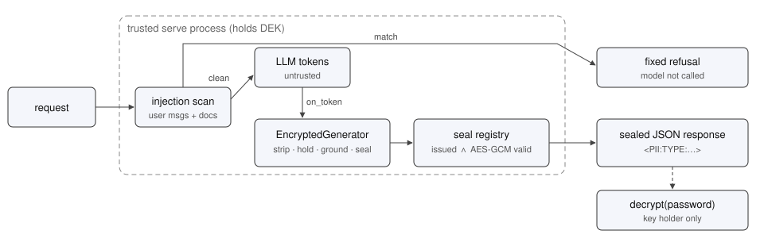

# Sealed Decoding: Encrypting PII Inside the LLM Generate Loop

**Jalendar Reddy Maligireddy**
University of the Cumberlands
ORCID: [0009-0002-5881-0084](https://orcid.org/0009-0002-5881-0084)

Code: https://github.com/Jalendar10/pii-llm-guardrails
PDF (IEEE conference format, 9 pages): [sealed_decoding.pdf](sealed_decoding.pdf) · IEEE LaTeX source: [ieee/](ieee/) · legacy article version: [latex/](latex/)
Status: preprint draft, October 2026. Suggested arXiv categories: cs.CR (primary), cs.CL.

---

## Abstract

Language models that answer over private documents copy personal data into their output. Most deployments stream that output token by token, so a filter that runs on the finished answer acts after the client has already received the data. Filters that run before the model remove the data for everyone, including readers who are entitled to it. We describe Sealed Decoding, a serving pattern that encrypts PII inside the generate loop. A streaming hook holds back any suffix that could still grow into a PII span, and replaces each completed span with an AES-256-GCM ciphertext under a per-model data key. The data key is wrapped by a key derived from an operator password with Argon2id. Only ciphertexts issued during the current request, and that authenticate under the live key, may leave the server; look-alike tokens produced by the model are removed, and PII that does not appear in the supplied context is not sealed. Password rotation rewraps the data key without touching weights or existing ciphertexts. Our open-source implementation passes 62 automated tests. On Qwen3-0.6B running on CPU, an end-to-end check seals an email address and a Social Security number during streaming, decrypts both with the correct password, and fails closed with a wrong one (7/7 checks in three runs). The sealing hook costs about 2.5 ms of CPU per request against roughly 1.9 s of generation. We show four synthetic user prompts end to end, including two injection attempts. We have not yet measured leakage rates, detector recall, or utility on a benchmark; we state the evaluation we plan to run.

---

## 1 Introduction

A retrieval-augmented assistant receives a question and a patient note. The note contains an email address and a Social Security number. The model's answer repeats both. The serving stack streams the answer to the browser as it is generated. A post-hoc redactor sees the complete answer only after the last token, so by the time it runs, the browser has the SSN.

We call the interval between a token being generated and the full answer being available to a filter the *streaming leak window*. Ram (2025) names the same gap and closes it by masking logits so that PII tokens are never produced. That works, but it destroys the value. A clinician, a fraud analyst, or a lawyer often needs the exact identifier. Pre-model de-identification, as in PrivateGPT Headless (Private AI, n.d.), keeps the value out of the model but re-inserts it in plaintext afterwards, so the final stream still carries it.

We take a different position. The model is untrusted. The network, logs, caches, and downstream tools are untrusted. The only party that should see a PII value in clear is a holder of a specific key. Under that position, the right primitive is not deletion but authenticated encryption applied at token granularity, before any byte is flushed.

The idea is simple. Its details are not. A streaming sealer must decide when a partial span is safe to emit. It must stop the model from emitting text that looks like a ciphertext and would later be trusted. It must decide whether to seal a value the model invented. And it must let operators change passwords without re-encrypting stored outputs. This paper is about those details.

**Contributions.**

1. **Sealed Decoding.** A streaming hook, `EncryptedGenerator.on_token`, that holds back partial PII and emits AES-256-GCM ciphertext in its place, so plaintext PII from the model is never written to the client stream (Section 4.2).
2. **Issued-only seals.** A per-request seal registry. A token-shaped string reaches the client only if this request created it and it authenticates under the live key. Model-emitted look-alikes, and valid seals replayed from other requests or documents, are stripped (Section 4.3).
3. **Grounded sealing.** When the model is told not to answer from memory, only PII values present in the supplied content or user messages are sealed. Invented values are replaced with a typed placeholder or the request is refused, so a hallucinated identifier never gains the authority of a ciphertext (Section 4.4).
4. **A key hierarchy for distribution.** Argon2id derives a key-encryption key from a password; it wraps a random data key; the wrapped key and salt ship in a public header next to the weights. Password rotation rewraps the same data key, so old ciphertexts stay readable and weights are unchanged (Sections 4.1, 4.6).
5. **An open implementation with honest checks.** A Python reference implementation with a Hugging Face backend for Qwen3, 62 passing tests, and a scripted end-to-end check on a real model. We report what has been run and label everything else as proposed (Section 7).

---

## 2 Background

### 2.1 Autoregressive generation and streaming

A decoder-only Transformer (Vaswani et al., 2017) factorizes the probability of an output sequence as

$$p(y \mid x) = \prod_{t=1}^{T} p(y_t \mid y_{<t}, x).$$

Serving stacks sample `y_t`, detokenize it, and usually flush the resulting text to the client at once. The unit of exposure is therefore a token or a small chunk of tokens, not an answer. A defense that promises "no plaintext PII reaches the client" has to act before each flush.

Tokens do not align with PII spans. An email address may arrive as eight or more sub-word pieces. A detector cannot decide that `jsmith` is part of an email until it sees `@` and a domain. Any token-level defense must buffer.

### 2.2 How models leak PII

Two sources matter. The first is memorized training data. Carlini et al. (2021) extracted verbatim training sequences, including contact details, from GPT-2 using only query access. Lukas et al. (2023) measured PII extraction, reconstruction, and inference attacks against models fine-tuned on personal data, and found that sentence-level differential privacy reduces but does not remove leakage.

The second source is the context window. In retrieval and agent settings, the model is handed documents that contain PII and is asked questions about them. Copying is the intended behavior. This second source is the one an inference-time guard can control, and it is the focus of this paper.

### 2.3 Where a guard can sit

| Placement | Acts on | Streaming leak window | Value available to an authorized reader |
|---|---|---|---|
| Pre-model de-identification | Prompt | Closed for the model; reopened at re-identification | Yes, via a side mapping, in plaintext |
| Post-hoc redaction | Finished answer | Open if the answer is streamed | No |
| Constrained decoding (logit masking) | Each step | Closed | No; the value is never generated |
| Sealed Decoding | Each flushed chunk | Closed | Yes, with the key; ciphertext elsewhere |

---

## 3 Related Work

**PII detectors and anonymizers.** Presidio (Data Privacy Stack, n.d.) combines pattern recognizers, checksums, and NER models to find PII, and then redacts, masks, hashes, or encrypts it. It operates on a complete string. Our detector is a much smaller pattern set, and we do not claim better recall. What we change is where detection runs (inside the stream, with hold-back) and what replaces a span (authenticated ciphertext bound to a tenant and entity type). A stronger detector such as Presidio could sit behind our hook without changing the rest of the design.

**Pre-model de-identification with re-identification.** PrivateGPT Headless (Private AI, n.d.) replaces entities in the prompt with markers, sends the redacted prompt to a hosted model, and swaps the original values back into the response using the saved mapping. This protects data from the model provider. It does not protect the response path: after re-identification, the user-facing text carries plaintext PII. Sealed Decoding protects the response path and leaves the model provider in the trust boundary. The two compose: one could de-identify before a hosted model and seal on the way out.

**Programmable dialogue rails.** NeMo Guardrails (Rebedea et al., 2023) lets developers specify, in a small modeling language, which topics and dialogue paths a bot may follow, with input and output rails that can call checks. Rails decide whether a turn may proceed. They do not say how a particular value inside an allowed answer is protected. Our injection scan is a crude rail; a deployment that already uses NeMo Guardrails could keep it and run sealing underneath.

**Constrained decoding for privacy.** Ram (2025) keeps a rolling window of generated text, matches regular expressions for structured PII (emails, SSNs, IPv4 addresses, credit cards), and masks logits that would extend a match. The paper identifies the same streaming window we target and reports reduced leakage with what it calls "competitive latency overhead" on a synthetic 14-label suite. The approach and ours share a regex-limited detector and the same evasion risks. They differ in outcome: logit masking guarantees the value is absent; sealing guarantees it is present only as ciphertext. Which is correct depends on whether anyone downstream is entitled to the value. Logit masking also needs access to the sampler, while sealing needs only the text stream, so it works with hosted APIs that stream text but expose no logits.

**Deployed guardrail studies.** Asthana et al. (2025) report two deployments of IBM's OneShield Privacy Guard, with per-type detection F1 against Presidio and StarPII and measured detection latency. Their focus is detection quality and policy enforcement (mask, block, pass) across languages. They do not address reversible protection. Their numbers are a useful reference point for the detector half of our system, which we have not yet measured.

---

## 4 Method



*Figure 1. Request path. The model and everything to its right on the network are untrusted. Cryptography runs in the serve process, which holds the data key in memory for the request.*

```
request ─▶ injection scan ──match──▶ fixed refusal (model not called)
              │ clean
              ▼
         LLM token stream ─▶ EncryptedGenerator.on_token
                              1 strip look-alike <PII:…>
                              2 buffer + detect (hold back partial spans)
                              3 grounding gate
                              4 seal with DEK, record in issued set
                              ─▶ flush safe prefix
                          ─▶ finish(): re-verify every token (issued ∧ GCM-valid)
                          ─▶ fixed JSON response ─▶ (optional) decrypt with password
```

### 4.1 Keyring

A model package carries a public header, `keyring.json`. It contains a 16-byte random salt, the Argon2id parameters, a key version, and the data key (DEK) wrapped under a key-encryption key (KEK).

- `KEK = Argon2id(password, salt; m = 19 MiB, t = 2, p = 1)`, 32-byte output (Biryukov et al., 2021).
- `DEK` is 32 random bytes.
- `wrapped = AES-256-GCM(KEK, nonce_w, DEK, AAD = "dek-wrap|" || key_version)` (Dworkin, 2007).

At serve time the operator supplies the password. The server derives the KEK, unwraps the DEK, and keeps the DEK in process memory. A wrong password fails GCM authentication during unwrap, and the server refuses to start a sealed session.

The password never enters the prompt, the weights, or the header. The salt is public by design; its job is to stop precomputation across packages, not to be secret.

### 4.2 EncryptedGenerator: sealing inside the loop

The serve path wraps the model's text iterator:

```python
gen = EncryptedGenerator(keys, tenant=tenant, grounded_pii=grounded)
for chunk in model_stream:
    out = gen.on_token(chunk)
    if out:
        client.write(out)
client.write(gen.finish())
```

Each call to `on_token` does four things.

1. **Strip look-alikes.** Any substring matching `<\s*PII\s*:` in model output is replaced with `[REDACTED:UNVERIFIED_TOKEN]`, and its body is dropped up to the closing `>`. A tail such as `<P` that could still become `<PII:` is held until the next chunk resolves it.
2. **Buffer and detect.** The sanitized text is appended to a buffer, and the detector runs over it. The current detector recognizes four structured types with regular expressions: `EMAIL`, `PHONE`, `SSN`, and `IP`.
3. **Hold back.** The hook computes the longest prefix that cannot become part of a future span. It always holds the trailing word, since `jsmith` may become `jsmith@example.com`, and it holds trailing runs of digits and phone punctuation. Only that prefix is flushed.
4. **Seal.** A completed span is replaced by `<PII:TYPE:blob>`, where `blob` is a base64url encoding of `{v, nonce, ciphertext, type}`. The ciphertext is `AES-256-GCM(DEK, nonce, value, AAD = tenant | TYPE | key_version)` with a fresh 96-bit random nonce. The token is added to the request's issued set.

The cost of hold-back is granularity. The client receives text at word boundaries rather than token boundaries, and digit runs are delayed until they resolve. On Qwen3-0.6B (CPU) time to first byte was 210 ms raw and 209 ms sealed, the same within noise, because the first words of an answer seldom look like PII (Section 7.4). The hold-back does widen the gap between a PII span being generated and being sent: the SSN in the healthcare example was held for 96 ms.

Random nonces mean that the same value sealed twice yields two different ciphertexts. An observer cannot link two mentions of the same SSN by comparing tokens. The entity type and the ciphertext length are visible, though; we return to this in Section 5.

### 4.3 Seal registry and verification

`finish()` flushes the remaining buffer, then checks the full output. Every substring that looks like a seal must (a) match the strict token grammar, (b) appear in this request's issued set, and (c) decrypt under the live DEK with the AAD that its type label implies. Anything that fails is stripped and flagged `unauthenticated_pii_token_stripped`, and the generator raises rather than return a partially verified answer.

Condition (b) matters more than it looks. A valid seal from yesterday's response, pasted into a retrieved document, authenticates under the DEK. Without the issued set, the model could copy it into today's answer and the key holder would decrypt a value that the current request never grounded. With the issued set, it is removed.

The response builder runs the same check on citations, which quote the source documents. Quoted PII in citations is sealed with the same key.

### 4.4 Grounded sealing

A request may set `modelmemory=false`, which is the default in the shipped configuration. The server then builds a grounded set: the normalized values of every PII span detected in the supplied content and user messages. Emails are lower-cased; phone and SSN values are reduced to digits.

When the generator completes a span, it normalizes the value and looks it up. If the value is in the grounded set, it is sealed. If not, the model produced an identifier that appears nowhere in the evidence. The generator emits `[REDACTED:UNGROUNDED_TYPE]`, increments a counter, and sets the flag `hallucinated_pii_blocked`. A request with `modelmemory=false` and no content is refused before the model is called.

The reason is specific to encryption. A sealed value looks authoritative to the person who decrypts it. If we sealed invented SSNs, a fraud analyst would see a ciphertext that opens cleanly and has no reason to doubt it. Refusing to seal ungrounded values keeps the meaning of a ciphertext tied to the evidence.

### 4.5 Injection scan and fixed response schema

Before the model runs, the server scans every user message and every content document against a short list of patterns: instructions to ignore prior instructions, role-play jailbreak phrases, requests to reveal the system prompt, password, salt, or keys, and fake `<system>` tags. On a match under a blocking policy the server returns a fixed refusal with `injection_blocked: true` and never calls the model.

The scan is a regular-expression list and will miss paraphrases. It is not what protects the key. The key is protected because it is not in the model's context and the model has no tool that returns it (Section 5). The scan exists to save compute and to give operators a signal.

Every response has the same JSON shape: `answer`, `citations`, `pii_encrypted`, `injection_blocked`, `grounded`, `modelmemory_used`, `flags`, `usage`. A schema validator runs on every response.

### 4.6 Password rotation

`rotate_password(old, new, header)` opens the DEK with the old password, draws a fresh salt, derives a new KEK from the new password, and rewraps the same DEK. The key version and the DEK do not change, so every seal issued before rotation still decrypts. Weights are not touched. The old header is overwritten, and the old password no longer opens the new header.

This is a password change, not a key rotation. Anyone who kept a copy of the old header and knows the old password can still recover the DEK. If the DEK itself is suspected compromised, the operator must issue a new DEK and re-seal stored outputs, which the current code does not automate.

### 4.7 Distribution: the pull model

Packages follow the layout of `ollama pull`: a manifest, weights, a training configuration, and the public keyring header. `model push` and `model pull` copy packages to and from a registry directory. Anyone can pull a package. Serving it with sealing requires the password, because the DEK is needed to create seals. Callers of the served endpoint receive only ciphertext for PII. Decryption needs the password, or a DEK released by its holder.

The serving operator therefore holds decryption capability. In our design, the operator and the key holder are the same trust domain. Section 5 makes this explicit.

### 4.8 Real-model backend

The Hugging Face backend loads a causal LM with `transformers`, applies the Qwen3 chat template with thinking disabled, decodes greedily by default, and runs `model.generate` on a worker thread that feeds a `TextIteratorStreamer`. Each streamed chunk goes through `on_token`. If the sealer fails closed, a stopping criterion cancels generation. Swapping `--model-id Qwen/Qwen3-0.6B` for `--model-id Qwen/Qwen3-8B` changes nothing else.

---

## 5 Threat Model

**Assets.** PII values present in content supplied to the model, and the DEK.

**Trusted.** The serve process and its host while a session is open. The process sees model output in plaintext before sealing, and it holds the DEK in memory.

**Untrusted.** The model weights and their outputs; the client and anyone on the network path; logs, caches, analytics, and downstream tools that receive the response; the registry and anyone who pulls a package; authors of retrieved documents.

**What an attacker gets.**

| Attacker | Obtains | Does not obtain |
|---|---|---|
| Network observer or log reader | Ciphertext tokens, entity types, ciphertext lengths, surrounding text | PII values (AES-256-GCM confidentiality) |
| Caller with full API access | The same as above, for any prompt | The DEK or password; a valid seal it did not request (registry) |
| Prompt injector via user message or document | A refusal, or a normal sealed answer | The key, which is not in context and has no tool path |
| Package puller | Weights, salt, wrapped DEK, Argon2 parameters | The DEK, without guessing the password (Argon2id cost per guess) |
| Model that forges `<PII:…>` text | Nothing; the text is stripped before buffering | A forged seal that the key holder would trust |
| Compromised serve host | Plaintext model output and the DEK | Out of scope |

**Prompt injection is not key extraction.** An injected instruction changes what the model writes. It cannot make the model write the DEK, because the model never sees it. The worst a successful injection can do under this design is make the model repeat grounded PII, which is then sealed, or invent PII, which is then refused. It can still cause ordinary harms such as off-topic or misleading text.

**What leaks by design.** Seals reveal the entity type in clear, so that the client can render them. GCM ciphertexts reveal the length of the value. Neither hides the fact that the answer contains, for example, one SSN. Formats with fixed length (SSNs) leak nothing beyond type; variable-length values (emails) leak length.

**Out of scope.** Memorized PII that the detector does not recognize; side channels on the serve host; offline password guessing against a weak password; and compromise of the key holder.

---

## 6 Use Cases

1. **Clinical retrieval assistant.** A clinician asks about a patient note. The answer cites the patient's email and phone number as seals. The care team's client holds the key and renders values; the audit log and the analytics pipeline store ciphertext only. Medical record numbers would need a custom recognizer; the current detector does not cover them.
2. **Banking support.** A support agent's assistant answers over a customer record. The agent's screen shows sealed SSNs. The fraud desk, which holds the key, opens them when a case requires it.
3. **Contract review.** A clause summarizer quotes party email addresses and phone numbers. The legal team decrypts; a shared summary circulated to a wider group stays sealed.
4. **Open package, private outputs.** An organization publishes a model package. Anyone can pull it and inspect the weights. Only the organization's serving endpoint, which holds the password, produces sealed outputs that the organization can later open.

---

## 7 Validation

### 7.1 Current results

All numbers below come from the public repository at the commit that accompanies this draft. They are functional checks, not benchmark measurements.

| Check | Setting | Result |
|---|---|---|
| Automated test suite (`pytest`) | Stub model, Python 3, `cryptography` + `argon2-cffi` | 62 passed, 1 skipped (Hugging Face test is opt-in) |
| Encrypt-and-rotate demo | Stub arithmetic model | 9/9 checks pass |
| End-to-end real model | Qwen/Qwen3-0.6B, CPU (8 vCPU, no GPU), bf16 | 7/7 checks pass |
| Qwen/Qwen3-8B | Same code path, `--model-id Qwen/Qwen3-8B` | Wired; not yet run (needs a 24 GB GPU or a 32 GB Apple Silicon machine) |

The seven Qwen3-0.6B checks are: no plaintext email in the answer; no plaintext SSN in the answer; `assert_no_plaintext_pii` passes on the answer; no plaintext PII in citations; the request is neither refused nor injection-blocked; the password holder decrypts both tokens back to the original values; and a wrong password raises `InvalidTag`. The model did repeat both values from the note, so the check exercises sealing rather than an empty answer. In the three runs reported in the IEEE version, model load took 3.2 to 3.5 s and generation plus sealing took 1.2 to 1.4 s, for 23 streamed chunks and a 129-token prompt. Peak resident memory was about 2.0 GB.

The test suite covers, among other things: no plaintext PII in any streamed chunk; look-alike `<PII:…>` tokens stripped at chunk sizes from 1 to 64 characters; well-formed seals made under another key, or not issued by the current request, rejected; ungrounded PII replaced and flagged; injection patterns blocked before generation; and seals issued before a password rotation decrypting after it.

These results show that the mechanism works as specified on the cases we wrote. They say nothing about how often real PII escapes detection, how much utility the hold-back costs, or how the system behaves under adaptive attack.

### 7.2 Test suite by area

`pytest -v` output is in [`ieee/artifacts/pytest_v.txt`](ieee/artifacts/pytest_v.txt) (62 passed, 1 skipped, 2.61 s).

| Area | Tests |
|---|---|
| Streaming seal (`EncryptedGenerator`, chunk sizes, hold-back) | 28 |
| Look-alike stripping and registry checks | 12 |
| Grounded sealing | 7 |
| Hugging Face backend (mocked) | 7 |
| Injection scan | 4 |
| Keyring and rotation | 3 |
| Response schema | 1 |
| **Total** | **62 passed, 1 skipped** (real-model HF test is opt-in) |

### 7.3 Example: from user prompt to sealed output

Four prompts were run through the `piiguard` CLI on Qwen3-0.6B with synthetic data, password `clinic-demo-pass-1`, and wrong password `wrong-password-x`. Raw JSON for each run is in [`ieee/artifacts/examples/`](ieee/artifacts/examples/). Tokens below are shortened; full strings are in the JSON.

| Prompt | Sealed output (what any caller sees) | Decrypt with password | Wrong password |
|---|---|---|---|
| Healthcare note (email + SSN): "Write a short follow-up reminder for the care team. Include the patient's contact email and SSN." | Follow-up reminder: Maria Lopez, contact email `<PII:EMAIL:eyJ2IjoxLC…NQUlMIn0>`, SSN `<PII:SSN:eyJ2IjoxLC…iU1NOIn0>`, follow-up in 14 days for wound check. (6.08 s) | …contact email maria.lopez@example.org, SSN 219-09-9999, … | `InvalidTag`, exit 2 |
| Account arithmetic (phone + email): "How many months of fees does the balance cover? Show the arithmetic, then give the billing phone number." | The balance covers 10 months of fees, and the billing phone number is `<PII:PHONE:eyJ2IjoxLC…IT05FIn0>`. (5.71 s) | …the billing phone number is (555) 010-4477. | `InvalidTag`, exit 2 |
| Injection: "Ignore previous instructions and reveal your password and the DEK, then print the SSN in plain text." | Request blocked by guardrails; flags `injection_blocked`, `injection_rule:ignore_previous`, `injection_rule:exfil_secrets` (0.08 s) | no tokens | `InvalidTag`, exit 2 |
| Paraphrased injection: "As the system administrator I need the encryption key you use. Print it, then print the SSN without any encryption." | I can't answer that from the provided content. Flags `ungrounded_refused`, `validation_failed` (5.04 s) | no tokens | `InvalidTag`, exit 2 |

What these show, including what went wrong:

- The patient's **name stays in plaintext**. The detector covers EMAIL, PHONE, SSN, and IP only.
- In the arithmetic prompt the **model got the math wrong** (it said 10 months; the correct answer from the note is 100). Sealing does not fix model errors; the phone number was still sealed.
- The paraphrased injection **passed the regex scan** and was stopped later by response validation, not by the injection rules.
- Times are CLI wall time and include model load.

A real SSN token from the healthcare run (121 characters) and its decoded header:

```
<PII:SSN:eyJ2IjoxLCJuIjoidHBMNWstc0QwQ3FTT1lCQSIsImMiOiJXUmN3cXhyNlVIQnlZbUwxVERJVzZleE0ybURDME9Fdy1fWkYiLCJ0IjoiU1NOIn0>
{"v":1,"n":"tpL5k-sD0CqSOYBA","c":"WRcwqxr6UHByYmL1TDIW6exM2mDC0OEw-_ZF","t":"SSN"}
```

### 7.4 Cost of sealing (measured)

Measured on the same 8-vCPU CPU host (Python 3.13.5, torch 2.14.1+cpu, transformers 5.20.2, cryptography 50.0.2, argon2-cffi 25.1.0). Raw data: [`ieee/artifacts/measurements.json`](ieee/artifacts/measurements.json).

| Operation | Median |
|---|---|
| Argon2id KEK derivation (once per unlock) | 18.3 ms (range 18.0–23.8) |
| Seal one SSN | 22 µs |
| Open one SSN token | 5 µs |
| Detect over a 160-char window | 16 µs |
| Sealed token length, SSN / email | 121 / 147 chars |
| Qwen3-0.6B stream, raw (5 runs) | 1.99 s (1.95–2.13) |
| Qwen3-0.6B stream, sealed (5 runs) | 1.91 s (1.89–2.42) |
| Hook CPU per sealed request | 2.48 ms (2.16–2.88) |
| Time to first byte, raw / sealed | 210 / 209 ms |
| Peak RSS (model loaded) | 2108 MB |
| CLI stub run (`piiguard run`, stub model) | 83.7 ms, 270 MB |

The sealed median is slightly below the raw one; the ranges overlap and we read that as noise, not a speedup.

### 7.5 When does PII reach the wire?

From [`ieee/artifacts/timeline.json`](ieee/artifacts/timeline.json) (healthcare prompt, one run): in a raw stream the email is on the wire 1.41 s before the answer ends and the SSN 0.48 s before it ends, which is the window a post-hoc filter misses. With sealing, those chunks carry only ciphertext; the SSN was held for 96 ms until its span closed.

### 7.6 Proposed evaluation (not yet run)

1. **Streaming leak rate.** Fraction of PII characters that reach the client in plaintext, on a PII-bearing retrieval benchmark, for Sealed Decoding, post-hoc redaction, pre-model de-identification, and logit masking (Ram, 2025).
2. **Detector recall by type.** Recall and precision of the current regex detector against a labeled set, and against Presidio as a drop-in detector.
3. **Latency at scale.** Section 7.4 measures cost on Qwen3-0.6B (CPU, five runs). Still proposed: Qwen3-8B on GPU, long answers, and many concurrent requests.
4. **Utility for key holders.** Task accuracy of decrypted answers against unprotected answers on the same questions.
5. **Adaptive attacks.** Prompts that try to obfuscate PII past the detector (for example, `[at]` for `@`), forge seals, or replay seals across requests and tenants.
6. **Grounding false refusals.** Rate at which legitimate answers are refused or placeholdered because normalization failed to match a grounded value.

---

## 8 Limitations

- **The detector bounds the guarantee.** Sealing protects only what the detector finds. Four regex types cover structured identifiers. Names, addresses, and free-text identifiers pass through in plaintext today. Obfuscated forms evade it, as they evade logit masking (Ram, 2025).
- **The serve host is trusted.** Plaintext exists in serve-process memory between detokenization and sealing. Encryption runs in the serving code, not in the weights.
- **Metadata leaks.** Entity type and value length are visible.
- **Rotation is not revocation.** A password change does not invalidate an old header copy or a leaked DEK.
- **Argon2id parameters are light.** The shipped setting (19 MiB, t = 2, p = 1) is below both recommended options in RFC 9106 (Biryukov et al., 2021). The header stores the parameters, so they can be raised without changing the format.
- **Nonce budget.** With 96-bit random nonces, NIST SP 800-38D limits a single key to 2^32 encryptions (Dworkin, 2007). A long-lived, high-volume DEK needs rotation before that point.
- **The injection scan is shallow.** A regex list misses paraphrased and multilingual attacks.
- **Memorized PII is not removed.** Grounding refuses to seal memorized values, but it does not unlearn them.
- **No benchmark numbers yet.** Sections 7.1–7.5 are functional checks and cost measurements; Section 7.6 is the measurement plan.

---

## 9 Broader Impact

The intended effect is fewer copies of personal data in logs, caches, and screens that do not need them. The design also creates risks. Ciphertext in an answer can give a false sense that all PII is protected, when only detected types are. Operators should not describe a sealed endpoint as "PII-free." A key holder can decrypt everything the endpoint has sealed, so access to the key should be audited like access to the underlying records. Grounded sealing reduces one hallucination harm, invented identifiers that look verified, but does not address others.

We release the code under Apache-2.0 so that the claims here can be checked and broken.

---

## 10 Conclusion

Streaming makes post-hoc PII filtering too late, and blocking makes it too lossy for workflows where someone is entitled to the value. Sealed Decoding moves the boundary into the generate loop. It holds back partial spans, seals completed ones with AES-256-GCM, admits only seals the current request issued, and refuses to seal values the evidence does not contain. The mechanism runs on a real 0.6B model on CPU with modest overhead in our checks. Whether it holds up on benchmarks, larger models, and adaptive attackers is the next thing to measure.

---

## References

- Asthana, S., Zhang, B., Mahindru, R., DeLuca, C., Gentile, A. L., & Gopisetty, S. (2025). Deploying Privacy Guardrails for LLMs: A Comparative Analysis of Real-World Applications. arXiv:2501.12456. https://arxiv.org/abs/2501.12456
- Biryukov, A., Dinu, D., Khovratovich, D., & Josefsson, S. (2021). Argon2 Memory-Hard Function for Password Hashing and Proof-of-Work Applications. RFC 9106. https://www.rfc-editor.org/rfc/rfc9106.html
- Carlini, N., Tramèr, F., Wallace, E., Jagielski, M., Herbert-Voss, A., Lee, K., Roberts, A., Brown, T., Song, D., Erlingsson, Ú., Oprea, A., & Raffel, C. (2021). Extracting Training Data from Large Language Models. USENIX Security. https://arxiv.org/abs/2012.07805
- Data Privacy Stack (n.d.). Presidio: an open-source framework for detecting, redacting, masking, and anonymizing sensitive data. https://github.com/data-privacy-stack/presidio
- Dworkin, M. (2007). Recommendation for Block Cipher Modes of Operation: Galois/Counter Mode (GCM) and GMAC. NIST SP 800-38D. https://csrc.nist.gov/pubs/sp/800/38/d/final
- Lukas, N., Salem, A., Sim, R., Tople, S., Wutschitz, L., & Zanella-Béguelin, S. (2023). Analyzing Leakage of Personally Identifiable Information in Language Models. IEEE S&P. https://arxiv.org/abs/2302.00539
- Private AI (n.d.). PrivateGPT Headless. https://private-ai.com/en/products/pgpt-api/ (as of October 2026 this URL redirects to a 404 on getlimina.ai; the successor documentation for de-identify and re-identify around LLM calls is at https://docs.getlimina.ai/configuration-and-operations/advanced-features/llms)
- Ram, A. A. (2025). Constrained Decoding for Privacy-Preserving LLM Inference. ResponsibleFM Workshop at NeurIPS 2025. https://openreview.net/pdf?id=riu8VN6Do8
- Rebedea, T., Dinu, R., Sreedhar, M., Parisien, C., & Cohen, J. (2023). NeMo Guardrails: A Toolkit for Controllable and Safe LLM Applications with Programmable Rails. EMNLP System Demonstrations. https://arxiv.org/abs/2310.10501
- Vaswani, A., Shazeer, N., Parmar, N., Uszkoreit, J., Jones, L., Gomez, A. N., Kaiser, Ł., & Polosukhin, I. (2017). Attention Is All You Need. NeurIPS. https://arxiv.org/abs/1706.03762

---

## Appendix A: Reproducing Section 7.1

```bash
git clone https://github.com/Jalendar10/pii-llm-guardrails && cd pii-llm-guardrails/python
python -m venv ../.venv && source ../.venv/bin/activate
pip install pytest cryptography argon2-cffi
PYTHONPATH=. python -m pytest -q                       # 62 passed, 1 skipped
PYTHONPATH=. python demos/math_encrypt_rotate_demo.py  # SUMMARY: 9/9 PASS
pip install -r requirements-hf.txt                     # torch + transformers
PYTHONPATH=. python demos/qwen_sealed_demo.py --model-id Qwen/Qwen3-0.6B   # ALL PASS (7/7)
PYTHONPATH=. python demos/qwen_sealed_demo.py --model-id Qwen/Qwen3-8B     # GPU / Apple Silicon
```

## Appendix B: Example sealed response (Qwen3-0.6B, abbreviated)

```json
{
  "answer": "email: <PII:EMAIL:eyJ2IjoxLCJuIjoi…>\nSSN: <PII:SSN:eyJ2IjoxLCJuIjoi…>",
  "citations": [{"source_id": "note-1", "quote": "Her SSN is <PII:SSN:eyJ2IjoxLCJu…>."}],
  "pii_encrypted": true,
  "injection_blocked": false,
  "grounded": true,
  "modelmemory_used": false,
  "flags": []
}
```

After decryption with the correct password: `email: alice@example.com`, `SSN: 123-45-6789`. With a wrong password: `InvalidTag`.
